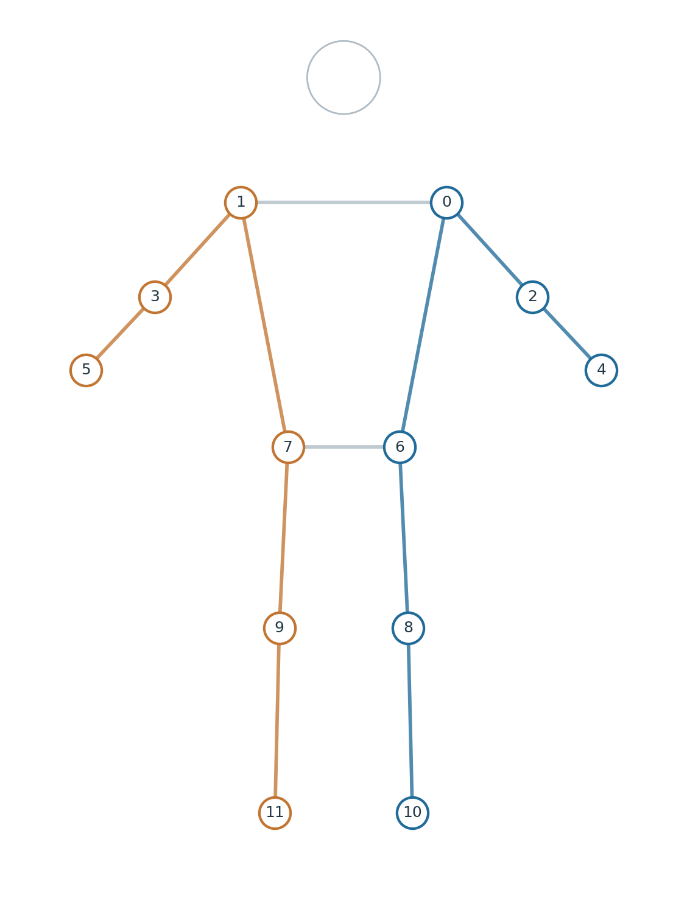
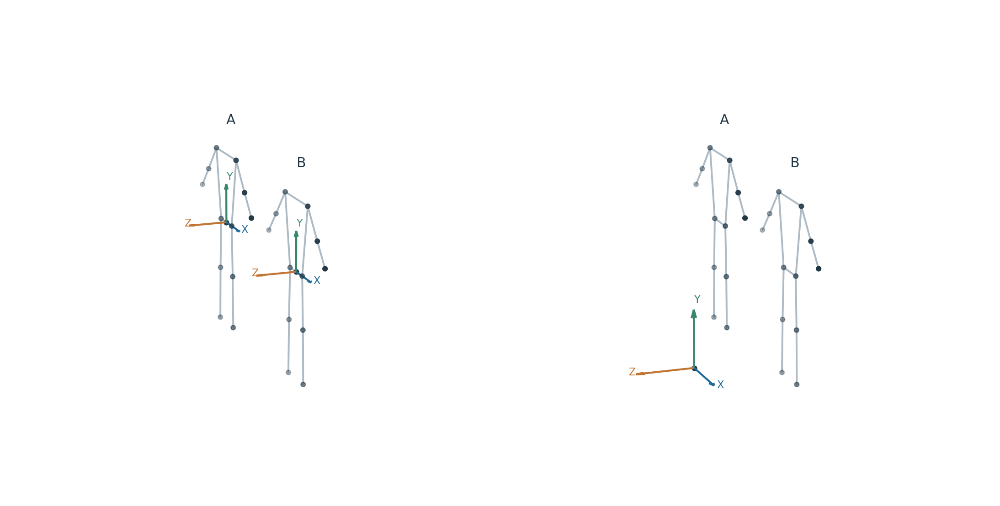
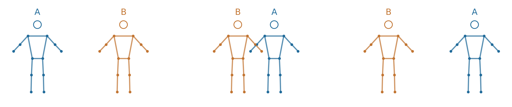
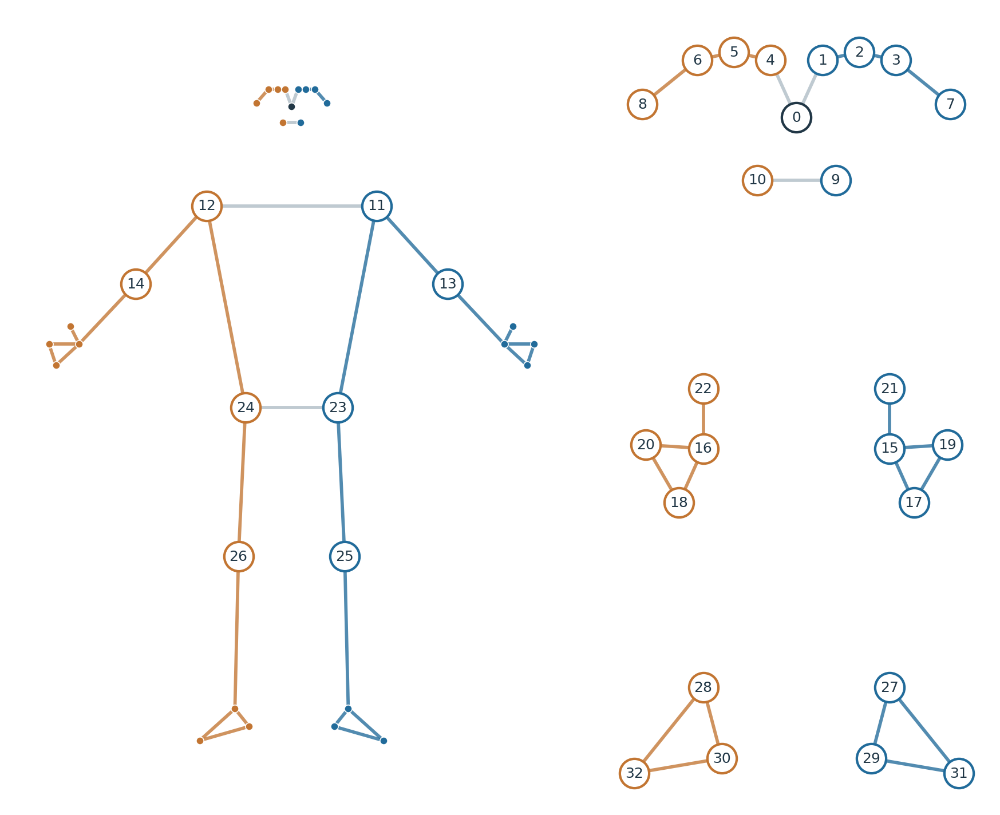

# 3D Body Tracking

Read 3D joint positions for every detected person from asMagic's **Body Tracking** feature on iPhone, using ARKit or MediaPipe.

## Choose the Recognition Model

Select ARKit or MediaPipe in the iPhone's Body Tracking settings and enable network streaming. Set `MODEL` in the Python examples to that same choice.

| App recognition model | Python setting | Joints per person | People per frame | TCP port |
| --- | --- | ---: | --- | ---: |
| ARKit | `MODEL = "arkit"` | 91 | 0 or 1 | 8100 |
| MediaPipe | `MODEL = "mediapipe"` | 33 | Multiple; up to 4 with the current App model | 8104 |

Both use `BodyTrackingDataSubscriber` and return `BodyTrackingFrame`. ARKit supplies joint positions and rotations. MediaPipe supplies positions and visibility/presence scores; its joint rotations are unavailable.

**ARKit and MediaPipe are the only recognition models.** `common` is an SDK skeleton layout that selects twelve joints from the chosen model's output; it is not a third model or a separate data stream.

## Receive Every Person and Every Joint

One received `frame` contains `frame.people`, a tuple of people detected in that camera frame. The loop below reads each `person` separately and labels the output with that person's display number and ID.

`person.skeleton()` includes all 91 ARKit joints or all 33 MediaPipe landmarks: upper body, legs, face and the hand/foot points supplied by that model. The [complete joint catalog](examples/joint-catalog.md) lists every row and its Python path.

```python
from asmagic import BodyTrackingDataSubscriber

IPHONE_IP = "192.168.1.100"  # Replace with your iPhone's IP address.
MODEL = "mediapipe"  # Match the App setting: "mediapipe" or "arkit".


def main():
    sub = BodyTrackingDataSubscriber(IPHONE_IP, model=MODEL)
    try:
        while True:
            frame = sub.receive()
            print("\nSource time (Unix seconds):", frame.timestamp)
            print("Model:", frame.model.value, "People:", frame.person_count)
            if not frame.people:
                print("No person detected in this frame")
                continue

            # Each iteration reads one person's complete skeleton.
            for person in frame.people:
                print(f"\nPerson {person.label} (ID: {person.id})")
                skeleton = person.skeleton()
                for row, name in enumerate(skeleton.names):
                    if skeleton.valid[row]:
                        print(f"  {name}: [x, y, z] (m)={skeleton.positions[row]}, "
                              f"usable={skeleton.usable[row]}")
                    else:
                        print(f"  {name}: body position unavailable")
                    if skeleton.rotation_valid[row]:
                        print(f"  {name}: rotation [qx, qy, qz, qw]="
                              f"{skeleton.rotations[row]}")
    except (KeyboardInterrupt, StopIteration):
        pass
    finally:
        sub.close()


if __name__ == "__main__":
    main()
```

With one person, the loop prints one person's data; with several people, it prints a separate group for each. With no people, it prints `No person detected in this frame`. A detected person can still have unavailable coordinates or low-quality joints.

## Read Joints by Name

In the examples, `person` is one item from `frame.people`. Its left and right joint names refer to **that person's own body**, regardless of screen position or preview mirroring.

The SDK's `common` layout selects shoulders, elbows, wrists, hips, knees and ankles on both sides: six body parts × two sides = twelve joints. It gives these joints the same anatomical names and a fixed row order for code shared between ARKit and MediaPipe.

### Where the common joints come from

- **ARKit:** the iPhone App reads the 91-node skeleton from `ARBodyAnchor.skeleton` and sends it on port 8100. The SDK maps twelve native joint names to the shared anatomical names.
- **MediaPipe:** the App's Pose Landmarker processes camera images and outputs 33 landmarks per person, sent on port 8104. The SDK selects twelve of those landmarks by index. The App also uses available scene depth and camera pose for camera/world registration.

| Shared body part | ARKit native name (left side) | MediaPipe indices (left / right) |
| --- | --- | --- |
| Shoulder | `left_arm_joint` | 11 / 12 |
| Elbow | `left_forearm_joint` | 13 / 14 |
| Wrist | `left_hand_joint` | 15 / 16 |
| Hip | `left_upLeg_joint` | 23 / 24 |
| Knee | `left_leg_joint` | 25 / 26 |
| Ankle | `left_foot_joint` | 27 / 28 |

ARKit's right-side names use `right_` in place of `left_`. For example, `left_arm_joint` becomes `person.joints.left_shoulder`; MediaPipe landmark 11 uses that same SDK name.

With `model="mediapipe"`, `person.skeleton(layout="common")` selects twelve rows from that person's 33 MediaPipe landmarks. With `model="arkit"`, it selects twelve from the 91 ARKit nodes. It does not combine the models, run another prediction, or generate missing positions or rotations. Coordinate conventions and available fields still depend on the source model; MediaPipe joint rotations remain unavailable.



| Common row | Read with | Location |
| ---: | --- | --- |
| 0 | `person.joints.left_shoulder` | Left shoulder |
| 1 | `person.joints.right_shoulder` | Right shoulder |
| 2 | `person.joints.left_elbow` | Left elbow |
| 3 | `person.joints.right_elbow` | Right elbow |
| 4 | `person.joints.left_wrist` | Left wrist |
| 5 | `person.joints.right_wrist` | Right wrist |
| 6 | `person.joints.left_hip` | Left hip |
| 7 | `person.joints.right_hip` | Right hip |
| 8 | `person.joints.left_knee` | Left knee |
| 9 | `person.joints.right_knee` | Right knee |
| 10 | `person.joints.left_ankle` | Left ankle |
| 11 | `person.joints.right_ankle` | Right ankle |

The diagram's numbers are rows in `person.skeleton(layout="common")`. The default layout has the selected model's full set of joints and a different row order.

The example explicitly selects all twelve joints. `body_joint` is the local variable for each joint selected from this list; each output line includes its anatomical location.

```python
from asmagic import BodyTrackingDataSubscriber

IPHONE_IP = "192.168.1.100"  # Replace with your iPhone's IP address.
MODEL = "mediapipe"  # Match the App setting: "mediapipe" or "arkit".


def print_person_joints(person):
    print(f"\nPerson {person.label} (ID: {person.id})")
    # Read both sides of the upper body and legs by their anatomical names.
    named_joints = [
        ("Left shoulder", person.joints.left_shoulder),
        ("Right shoulder", person.joints.right_shoulder),
        ("Left elbow", person.joints.left_elbow),
        ("Right elbow", person.joints.right_elbow),
        ("Left wrist", person.joints.left_wrist),
        ("Right wrist", person.joints.right_wrist),
        ("Left hip", person.joints.left_hip),
        ("Right hip", person.joints.right_hip),
        ("Left knee", person.joints.left_knee),
        ("Right knee", person.joints.right_knee),
        ("Left ankle", person.joints.left_ankle),
        ("Right ankle", person.joints.right_ankle),
    ]
    for location, body_joint in named_joints:
        if body_joint is None:
            print(f"  {location}: joint unavailable")
            continue
        print(f"  {location}: body [x, y, z] (m)={body_joint.position}")
        print(f"  {location}: world [x, y, z] (m)={body_joint.world_position}")
        print(f"  {location}: rotation [qx, qy, qz, qw]={body_joint.rotation}")
        print(f"  {location}: usable={body_joint.usable}")


def main():
    sub = BodyTrackingDataSubscriber(IPHONE_IP, model=MODEL)
    try:
        while True:
            frame = sub.receive()
            print("\nPeople:", frame.person_count)
            if not frame.people:
                print("No person detected in this frame")
            for person in frame.people:
                print_person_joints(person)
    except (KeyboardInterrupt, StopIteration):
        pass
    finally:
        sub.close()


if __name__ == "__main__":
    main()
```

A missing joint object is `None`. An existing joint can also have `None` for a particular position or rotation, such as world positions without registration or MediaPipe joint rotations.

### Joint Position, Rotation and Quality

Every body joint supports these properties. The examples use different body parts and both sides; check that the joint exists before reading a full path.

| Property | Read with (example) | Format / meaning |
| --- | --- | --- |
| `position` | `person.joints.left_shoulder.position` | Body-relative `[x, y, z]` in meters, or `None` |
| `world_position` | `person.joints.right_hip.world_position` | World `[x, y, z]` in meters, or `None` |
| `camera_position` | `person.joints.left_knee.camera_position` | Camera `[x, y, z]` in meters; MediaPipe when available |
| `model_position` | `person.joints.right_ankle.model_position` | MediaPipe's learned hip-relative metric estimate |
| `image_position` | `person.joints.left_wrist.image_position` | MediaPipe's normalized image `[x, y]`, or `None` |
| `parent_position` | `person.joints.right_elbow.parent_position` | Position relative to the joint's parent; ARKit when available |
| `rotation` | `person.joints.left_hip.rotation` | Body-space `[qx, qy, qz, qw]` quaternion; ARKit, or `None` |
| `world_rotation`, `parent_rotation` | `person.joints.right_shoulder.world_rotation` | ARKit quaternion in the selected coordinate space, or `None` |
| `visibility`, `presence` | `person.joints.right_wrist.visibility` | MediaPipe scores from 0 to 1; `None` for ARKit |
| `tracked` | `person.joints.left_ankle.tracked` | ARKit direct-tracking flag; `None` for MediaPipe |
| `usable` | `person.joints.right_knee.usable` | Body position exists and the SDK's quality criterion is met |

For MediaPipe, `usable` requires both visibility and presence to be at least 0.5. For ARKit, it requires an explicitly tracked joint. Low-quality joints remain readable; availability and quality are separate.

MediaPipe's hand landmarks are sparse body-pose points. For all 21 joints of each hand, use the separate [Hand Tracking](hands.md) stream.

## Coordinate Spaces



Body-relative coordinates describe each person's posture around their own body origin. World coordinates place people in the same room coordinate frame; compare them only when world data exists and `frame.world_frame_id` matches.

| `space` | Meaning | ARKit | MediaPipe |
| --- | --- | --- | --- |
| `"body"` (default) | Body-relative positions in meters | Body-model origin | Hip midpoint, with X toward anatomical left, Y up the torso, Z forward |
| `"world"` | AR session world positions in meters, Y up | When the body transform is available | When registration succeeds |
| `"camera"` | Camera positions in meters; X right, Y up, camera looks along -Z | Unavailable | When registration succeeds |
| `"model"` | Learned hip-relative metric estimate in the App's camera-axis convention | Unavailable | Available |
| `"image"` | Normalized image `[x, y]`; top-left origin, X right, Y down | Unavailable | Available |
| `"parent"` | Each joint relative to its own parent, in meters | When supplied | Unavailable |

Use `person.skeleton(space="world")` to read all world positions, or `person.joints.left_shoulder.world_position` for a specific joint. Unavailable values are `None` for a joint or `NaN` with `valid=False` in arrays.

MediaPipe body/model estimates can exist without depth; camera/world registration additionally depends on depth and camera pose. Matching joint names does not make the two models' local axes or measurements identical.

## Read Skeleton Arrays

`person.skeleton()` returns `BodyTrackingSkeleton`. All fields use the same row order within that snapshot.

| Layout | Call | Number of rows |
| --- | --- | ---: |
| Complete model output | `person.skeleton()` | 33 for MediaPipe, 91 for ARKit |
| Twelve shared major joints | `person.skeleton(layout="common")` | 12 for either model |

ARKit extension joints, if supplied, append after its 91 standard rows. Use `skeleton.names` to identify rows rather than assuming a common row number matches the complete model's row number.

| Field | Type and shape | Meaning |
| --- | --- | --- |
| `names` | `tuple[str, ...]`, length N | Joint name for each row |
| `positions` | NumPy `float32`, `(N, 3)`; `(N, 2)` for image space | Coordinates in the requested space |
| `rotations` | NumPy `float32`, `(N, 4)` | `[qx, qy, qz, qw]` rotations in the requested space |
| `valid` | NumPy `bool`, `(N,)` | Position available in this space |
| `rotation_valid` | NumPy `bool`, `(N,)` | Rotation available in this space |
| `usable` | NumPy `bool`, `(N,)` | Position available and joint quality criterion met |
| `visibility`, `presence` | NumPy `float32`, `(N,)` | MediaPipe quality scores; `NaN` when unavailable |
| `tracked`, `tracking_known` | NumPy `bool`, `(N,)` | ARKit direct-tracking flag and whether that flag was supplied |
| `bones` | NumPy `int32`, `(M, 2)` | Pairs of row IDs to connect when drawing the skeleton |
| `parent_indices` | NumPy `int32`, `(N,)` | ARKit parent row IDs; `-1` when unavailable |

The example reads all twelve shared rows for every person, prints the main arrays, and compares body/world positions by joint name. Remove `layout="common"` from both calls to read the complete 33- or 91-joint output.

```python
from asmagic import BodyTrackingDataSubscriber

IPHONE_IP = "192.168.1.100"  # Replace with your iPhone's IP address.
MODEL = "mediapipe"  # Match the App setting: "mediapipe" or "arkit".


def main():
    sub = BodyTrackingDataSubscriber(IPHONE_IP, model=MODEL)
    try:
        while True:
            frame = sub.receive()
            if not frame.people:
                print("No person detected in this frame")
                continue
            for person in frame.people:
                # Omit layout="common" to read all 33 or 91 model-specific rows.
                body = person.skeleton(space="body", layout="common")
                world = person.skeleton(space="world", layout="common")
                print(f"\nPerson {person.label} (ID: {person.id})")
                print("Joint names:", body.names)
                print("Body positions [x, y, z] (m):\n", body.positions)
                print("Position available:", body.valid)
                print("Usable positions:", body.usable)
                print("Rotations [qx, qy, qz, qw]:\n", body.rotations)
                print("Rotation available:", body.rotation_valid)
                print("Available body positions only:\n", body.positions[body.valid])

                # A row identifies the same joint in the body and world arrays.
                for row, name in enumerate(body.names):
                    body_position = body.positions[row] if body.valid[row] else None
                    world_position = world.positions[row] if world.valid[row] else None
                    print(f"Row {row} ({name}): body={body_position}, "
                          f"world={world_position}")
    except (KeyboardInterrupt, StopIteration):
        pass
    finally:
        sub.close()


if __name__ == "__main__":
    main()
```

Missing values remain in their original rows as `NaN`; masks mark whether they are available. `positions[valid]` selects available positions. MediaPipe's `rotation_valid` is false for every row because it supplies no joint rotations.

## Keep Track of the Same Person



MediaPipe gives people track IDs within a capture session. Array order can change; `frame.person(person_id)` finds the requested ID in the current frame and returns `None` when it is absent.

This example chooses the first detected track once, then reads that same ID. It reports when the person disappears or the session changes. To choose another target, use an ID printed by the first receiving example; `frame.selected_person` also provides the target selected in the App when present.

```python
from asmagic import BodyTrackingDataSubscriber

IPHONE_IP = "192.168.1.100"
MODEL = "mediapipe"  # This example uses MediaPipe multi-person output.


def main():
    sub = BodyTrackingDataSubscriber(IPHONE_IP, model=MODEL)
    target_id = None
    target_session = None
    try:
        while True:
            frame = sub.receive()
            if target_id is None and frame.people:
                # Choose an initial track once. Keep its ID after tracking loss.
                target_id = frame.people[0].id
                target_session = frame.session_id
                print("Chosen person:", target_id)
            if target_id is None:
                continue
            if frame.session_id != target_session:
                print("Session changed. Choose a new person explicitly.")
                continue
            person = frame.person(target_id)
            if person is None:
                print("Chosen person is absent:", target_id)
                continue
            print("Person:", person.id, "Identity ambiguous:", person.identity_ambiguous)
            skeleton = person.skeleton()
            print("All joint names:", skeleton.names)
            print("Body positions (m):", skeleton.positions)
            print("Position available:", skeleton.valid)
    except (KeyboardInterrupt, StopIteration):
        pass
    finally:
        sub.close()


if __name__ == "__main__":
    main()
```

Use `(frame.session_id, person.id)` as the track key. A new session or a recreated track can have a new ID. `person.label` is a display number; `person.identity_ambiguous` flags uncertain identity assignment.

ARKit provides one body slot with ID `"body"`. That slot does not establish that the same human returned after tracking loss.

## MediaPipe Image Landmarks and Pixels



MediaPipe includes 33 image landmarks covering face, arms, sparse hand points, hips, legs and feet. The numbers in this schematic match rows in `person.skeleton(space="image")`; see the complete catalog for each location.

Multiply normalized `[x, y]` by `[frame.image_width, frame.image_height]` to get continuous pixel coordinates. Use image dimensions from the same frame and skip conversion when they are unavailable.

```python
import numpy as np
from asmagic import BodyTrackingDataSubscriber

IPHONE_IP = "192.168.1.100"  # Replace with your iPhone's IP address.
MODEL = "mediapipe"  # Image landmarks are available with MediaPipe.


def main():
    sub = BodyTrackingDataSubscriber(IPHONE_IP, model=MODEL)
    try:
        while True:
            frame = sub.receive()
            width, height = frame.image_width, frame.image_height
            print("\nImage size (width, height):", (width, height))
            if not frame.people:
                print("No person detected in this frame")
                continue
            for person in frame.people:
                image = person.skeleton(space="image")
                print(f"\nPerson {person.label} (ID: {person.id})")
                print("All 33 landmark names:", image.names)
                print("Normalized image positions [x, y]:\n", image.positions)
                print("Position available:", image.valid)
                if width is not None and height is not None and width > 0 and height > 0:
                    pixels = image.positions * np.array([width, height])
                    print("Pixel positions for available landmarks:\n", pixels[image.valid])
                else:
                    print("Image size unavailable; skip pixel conversion")
                print("Visibility:", image.visibility)
                print("Presence:", image.presence)
    except (KeyboardInterrupt, StopIteration):
        pass
    finally:
        sub.close()


if __name__ == "__main__":
    main()
```

Predicted image landmarks can fall outside the image. Check bounds before indexing an image array and apply the preview's display transform when drawing overlays.

## Display Every Person's Skeleton

`TrackingPlotter` displays the complete received skeleton for each person in a separate panel. `min_confidence` affects drawing; all received joint rows remain available for reading. Set `space="world"` to display world coordinates when present.

```python
from asmagic import BodyTrackingDataSubscriber, TrackingPlotter

IPHONE_IP = "192.168.1.100"
MODEL = "mediapipe"  # Match the App setting: "mediapipe" or "arkit".
SHOW_SKELETON = True


def main():
    sub = BodyTrackingDataSubscriber(IPHONE_IP, model=MODEL)
    plotter = None
    try:
        plotter = TrackingPlotter(space="body", min_confidence=0.5) if SHOW_SKELETON else None
        while plotter is None or plotter.is_open:
            frame = sub.receive(timeout=50 if plotter is not None else 1000)
            if frame is None:
                if plotter is not None:
                    plotter.idle()
                continue
            print("People:", frame.person_count, "IDs:", [person.id for person in frame.people])
            if plotter is not None:
                plotter.update(frame)
    except (KeyboardInterrupt, StopIteration):
        pass
    finally:
        sub.close()
        if plotter is not None:
            plotter.close()


if __name__ == "__main__":
    main()
```

Run plotting on the main thread with a GUI Matplotlib backend. Closing the window or pressing Ctrl-C closes the receiver.

## API Reference

### BodyTrackingDataSubscriber

**Constructor:** `BodyTrackingDataSubscriber(ip, model="mediapipe")`

`model` is required and must match the App. The default port is 8100 for ARKit or 8104 for MediaPipe; use `port=...` only when overriding it.

| Method | Returns | Meaning |
| --- | --- | --- |
| `receive()` | `BodyTrackingFrame` | Wait for a valid frame, including an empty detection |
| `receive(timeout=1000)` | `BodyTrackingFrame` or `None` | Wait up to 1000 milliseconds; `None` on timeout |
| `close()` | `None` | Close the receiver |

Receiving after closure raises `StopIteration`. See [Common Subscriber API](api.md) for timeout values.

### BodyTrackingFrame

| Property or method | Type / meaning |
| --- | --- |
| `people` | `tuple[BodyTrackingPerson, ...]`; all people present in this frame |
| `person_count`, `is_tracking` | Number of people / whether any person is present |
| `model` | `BodyTrackingModel`; `frame.model.value` is `"arkit"` or `"mediapipe"` |
| `timestamp` | Sender Unix seconds associated with this body frame |
| `source_timestamp` | Source ARFrame monotonic seconds on the iPhone |
| `session_id` | Capture session identifier, used with person IDs |
| `world_frame_id` | World-origin identifier for comparing world positions |
| `tracking_state` | Current body/camera tracking state |
| `person(person_id)` | Person with that ID in this frame, or `None` |
| `selected_person` | App-selected MediaPipe person when present, or `None` |
| `image_width`, `image_height` | MediaPipe image dimensions in pixels; `None` for ARKit |
| `camera_world_transform` | MediaPipe camera-to-world matrix, NumPy `float32` `(4, 4)`, or `None` |
| `camera_intrinsics` | MediaPipe camera intrinsics, NumPy `float32` `(3, 3)`, or `None` |

`timestamp` and `source_timestamp` use different clocks. ARKit's Unix timestamp is its body callback time; MediaPipe carries capture-associated Unix time. `source_timestamp` is the source camera's monotonic time and is not synchronized to the receiving computer.

### BodyTrackingPerson

| Property or method | Type / meaning |
| --- | --- |
| `id`, `label` | Track/slot ID and the App's display number |
| `joints` | Named joints; read the paths in the joint tables |
| `joint_names` | Complete ordered joint-name tuple for this model |
| `skeleton(space="body", layout="native")` | `BodyTrackingSkeleton` arrays in the requested space and layout |
| `has_world_coordinates` | Whether any world joint position is available |
| `identity_ambiguous` | MediaPipe identity ambiguity flag, or `None` |
| `body_transform` | Body origin in world coordinates, or `None` |
| `body_camera_transform` | MediaPipe body origin in camera coordinates, or `None` |

Body transforms expose `position` (`[x, y, z]` in meters), `rotation` (`[qx, qy, qz, qw]`) and `matrix` (4×4). Joint properties are described in [Joint Position, Rotation and Quality](#joint-position-rotation-and-quality); array fields are described in [Read Skeleton Arrays](#read-skeleton-arrays).
