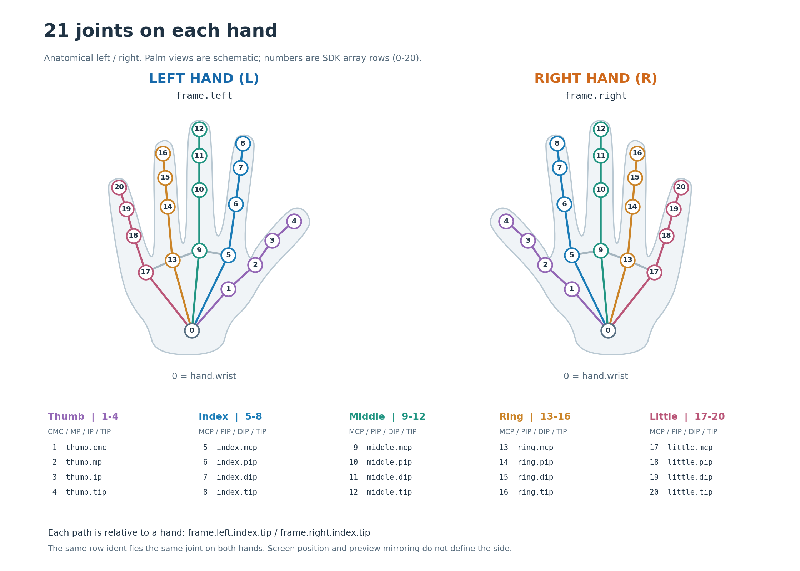
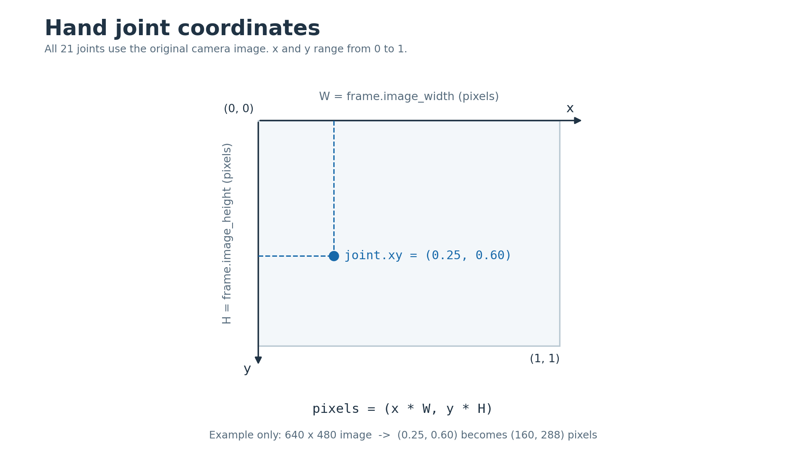

# Hand Tracking Receiving Examples

Hand joints from Stream or Face and Hand Tracking. Read `frame.left.index.tip` or `frame.right.thumb.tip` after checking hand and joint presence.

[Left/right, all 21 joint locations and window API](../hands.md)





[All examples](index.md) · [Data format and API](api-reference.md)

Replace `IPHONE_IP` with your iPhone's IP and start the matching App output. For Watch, enter your computer's IP on Watch. Ctrl-C stops receiving.

## Example 1: Read all joints from both hands

Print all 21 named joints separately for the left and right hand, including the wrist and every finger. Missing hands and joints are reported explicitly.

Source: [hand/01_both_hands.py](../../examples/documentation/hand/01_both_hands.py)

Run from the SDK project directory:

```bash
python examples/documentation/hand/01_both_hands.py
```

```python
from asmagic import HandPoseDataSubscriber

IPHONE_IP = "192.168.1.100"  # Replace with your iPhone's IP address.


def print_hand_joints(side, hand):
    print(f"\n{side} hand:")
    if hand is None:
        print("  Not detected")
        return

    # Select the wrist and all four joints of each of the five fingers.
    named_joints = [
        ("Wrist", hand.wrist),
        ("Thumb palm base (CMC)", hand.thumb.cmc),
        ("Thumb knuckle (MP)", hand.thumb.mp),
        ("Thumb middle joint (IP)", hand.thumb.ip),
        ("Thumb fingertip", hand.thumb.tip),
        ("Index knuckle (MCP)", hand.index.mcp),
        ("Index middle joint (PIP)", hand.index.pip),
        ("Index joint near fingertip (DIP)", hand.index.dip),
        ("Index fingertip", hand.index.tip),
        ("Middle knuckle (MCP)", hand.middle.mcp),
        ("Middle middle joint (PIP)", hand.middle.pip),
        ("Middle joint near fingertip (DIP)", hand.middle.dip),
        ("Middle fingertip", hand.middle.tip),
        ("Ring knuckle (MCP)", hand.ring.mcp),
        ("Ring middle joint (PIP)", hand.ring.pip),
        ("Ring joint near fingertip (DIP)", hand.ring.dip),
        ("Ring fingertip", hand.ring.tip),
        ("Little knuckle (MCP)", hand.little.mcp),
        ("Little middle joint (PIP)", hand.little.pip),
        ("Little joint near fingertip (DIP)", hand.little.dip),
        ("Little fingertip", hand.little.tip),
    ]
    for location, hand_joint in named_joints:
        if hand_joint is None:
            print(f"  {location}: not detected")
        else:
            print(f"  {location}: (x, y)={hand_joint.xy}, "
                  f"confidence={hand_joint.confidence}")


def main():
    sub = HandPoseDataSubscriber(IPHONE_IP)
    try:
        while True:
            frame = sub.receive()
            print("\nTime:", frame.timestamp)
            print_hand_joints("Left", frame.left)
            print_hand_joints("Right", frame.right)
            if frame.unknown_hand_count:
                print("Hands with unassigned side:", frame.unknown_hand_count)
    except (KeyboardInterrupt, StopIteration):
        pass
    finally:
        sub.close()


if __name__ == "__main__":
    main()
```

## Example 2: Wrist and all five fingertips in image coordinates

Read the wrist and all five fingertips of both hands, then convert normalized coordinates to pixels using image dimensions from the same frame.

Source: [hand/02_named_joints_and_pixels.py](../../examples/documentation/hand/02_named_joints_and_pixels.py)

Run from the SDK project directory:

```bash
python examples/documentation/hand/02_named_joints_and_pixels.py
```

```python
from asmagic import HandPoseDataSubscriber

IPHONE_IP = "192.168.1.100"  # Replace with your iPhone's IP address.


def print_hand_pixels(side, hand, width, height):
    print(f"\n{side} hand:")
    if hand is None:
        print("  Not detected")
        return

    named_joints = [
        ("Wrist", hand.wrist),
        ("Thumb fingertip", hand.thumb.tip),
        ("Index fingertip", hand.index.tip),
        ("Middle fingertip", hand.middle.tip),
        ("Ring fingertip", hand.ring.tip),
        ("Little fingertip", hand.little.tip),
    ]
    for location, hand_joint in named_joints:
        if hand_joint is None:
            print(f"  {location}: not detected")
            continue
        print(f"  {location}: normalized (x, y)={hand_joint.xy}")
        if width > 0 and height > 0:
            print(f"  {location}: pixels (x, y)="
                  f"{hand_joint.to_pixels(width, height)}")


def main():
    sub = HandPoseDataSubscriber(IPHONE_IP)
    try:
        while True:
            frame = sub.receive()
            width, height = frame.image_width, frame.image_height
            print("\nTime:", frame.timestamp)
            print("Image size (width, height):", (width, height))
            if width <= 0 or height <= 0:
                print("Image size unavailable; printing normalized coordinates only")
            print_hand_pixels("Left", frame.left, width, height)
            print_hand_pixels("Right", frame.right, width, height)
    except (KeyboardInterrupt, StopIteration):
        pass
    finally:
        sub.close()


if __name__ == "__main__":
    main()
```

## Example 3: Read all hand joints as arrays

Print names, points, confidences and validity separately for each hand, then read every row and select present joints with the validity mask.

Source: [hand/04_joint_arrays.py](../../examples/documentation/hand/04_joint_arrays.py)

Run from the SDK project directory:

```bash
python examples/documentation/hand/04_joint_arrays.py
```

```python
from asmagic import HandPoseDataSubscriber

IPHONE_IP = "192.168.1.100"  # Replace with your iPhone's IP address.


def print_hand_arrays(side, hand):
    print(f"\n{side} hand:")
    if hand is None:
        print("Not detected")
        return

    joints = hand.as_arrays()

    # The same row refers to the same joint in all four fields.
    print("Joint names:", joints.names)
    print("Normalized positions [x, y]:\n", joints.points)
    print("Joint confidences:", joints.confidences)
    print("Joint present:", joints.valid)

    # Print every row: wrist, thumb, index, middle, ring and little finger.
    for row, name in enumerate(joints.names):
        if joints.valid[row]:
            print(f"Row {row} ({name}): [x, y]={joints.points[row]}, "
                  f"confidence={joints.confidences[row]}")
        else:
            print(f"Row {row} ({name}): not detected")

    # Boolean indexing selects only the joints that are present.
    print("Present joint positions:\n", joints.points[joints.valid])


def main():
    sub = HandPoseDataSubscriber(IPHONE_IP)
    try:
        while True:
            frame = sub.receive()
            print("\nTime:", frame.timestamp)
            print_hand_arrays("Left", frame.left)
            print_hand_arrays("Right", frame.right)
    except (KeyboardInterrupt, StopIteration):
        pass
    finally:
        sub.close()


if __name__ == "__main__":
    main()
```

## Example 4: Enable or disable both hand skeletons

Use receive(timeout=50) so the window handles events even without new data. A timeout returns None; an empty hand observation is still a HandPoseFrame. Close the window or press Ctrl-C to finish.

Source: [hand/03_optional_skeleton.py](../../examples/documentation/hand/03_optional_skeleton.py)

Run from the SDK project directory:

```bash
python examples/documentation/hand/03_optional_skeleton.py
```

```python
from asmagic import HandPoseDataSubscriber, HandTrackingWindow

IPHONE_IP = "192.168.1.100"  # Replace with your iPhone's IP address.
SHOW_SKELETON = True


def main():
    sub = HandPoseDataSubscriber(IPHONE_IP)
    viewer = None
    try:
        viewer = HandTrackingWindow(labels=True, min_confidence=0.5) if SHOW_SKELETON else None
        while True:
            frame = sub.receive(timeout=50)
            if viewer is not None:
                if not viewer.is_open:
                    break
                viewer.update(frame)
            if frame is None:
                continue
            print("Time:", frame.timestamp)
            print("Left hand detected:", frame.left is not None)
            print("Right hand detected:", frame.right is not None)
    except (KeyboardInterrupt, StopIteration):
        pass
    finally:
        if viewer is not None:
            viewer.close()
        sub.close()


if __name__ == "__main__":
    main()
```
