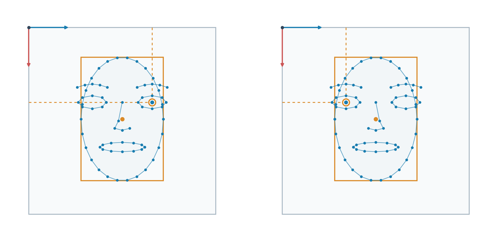
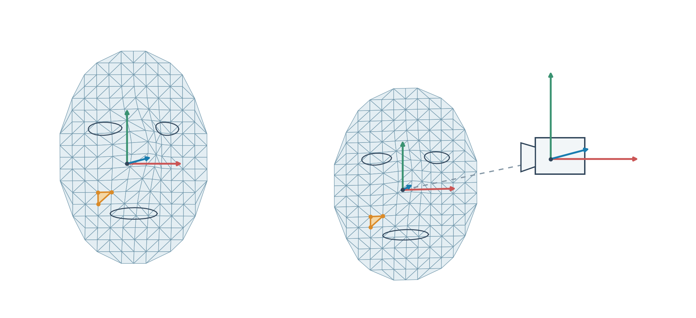

# 面部和手部数据

面部与手部是两个独立数据流。面部使用 **TCP 8102、`Phone.FaceTrackingFrame` 和 `FaceDataSubscriber(ip)`**；手部使用 **TCP 8101、`Phone.HandPoseFrame` 和 `HandPoseDataSubscriber(ip)`**。在 Face and Hand Tracking 中开启 **Face tracking** 并点 **Send face**；需要手部时另行开启 **Hand tracking** 并点 **Send hands**。Stream 的手部输出也使用 8101。

面部接收器返回 `asmagic.FaceFrame`，包含检测状态、图像元数据、脸部区域点、边界框、朝向，以及 TrueDepth 模式的动作系数、米制位置和网格。两个发送按钮独立启停，两个流各自保留来源图像的时间戳，不能按接收顺序当成严格同步帧。

旧 `FaceAndHandTrackingDataSubscriber` / `FaceAndHandTrackingFrame` 保留用于解码旧 App 合并帧；当前面部帧没有嵌套手部成员。见 [手部示例](examples/hand.md)、[面部独立示例](examples/face.md) 和 [协议与端口](protocols.md#face-and-hands)。

## 接收面部数据

修改 `IPHONE_IP` 后运行；Ctrl-C 结束并关闭接收器。

```python
from asmagic import FaceDataSubscriber

IPHONE_IP = "192.168.1.100"  # Replace with your iPhone's IP address.


def main():
    sub = FaceDataSubscriber(IPHONE_IP)
    try:
        while True:
            frame = sub.receive()
            print("Time:", frame.timestamp)
            print("Face detected:", frame.has_face)
            print("Face points:", frame.points)
            print("Expressions:", frame.blendshapes)
            print("Position (m):", frame.camera_position_meters)
            print("Orientation:", frame.camera_orientation)
    except KeyboardInterrupt:
        pass
    finally:
        sub.close()


if __name__ == "__main__":
    main()
```

`receive()` 等待下一条成功解码的帧；`receive(timeout=1000)` 在毫秒超时内返回 `FaceFrame` 或 `None`。`frame is None` 表示没有读到新帧；`frame.has_face=False` 表示读到了帧，但该来源图像中没有检测到脸部。旧 `get()` / `get_frame()` 方法继续兼容。

## 两种跟踪模式与缺失数据

| 数据 | `true_depth` | `vision` | 当前 App 检测不到脸部时 |
| --- | --- | --- | --- |
| 检测来源 | ARKit 面部锚点 | Vision 人脸观测 | `has_face=False` |
| `image_location` | 网格投影边界框 | 识别到的人脸边界框 | `None` |
| `landmarks` / `points` | 网格顶点在图像中的投影 | 按脸部区域分组的二维点 | `()` / shape 为 `(0, 2)` 的 float32 数组 |
| `camera_orientation` | 面部相对相机的 ARKit 四元数 | 由 Vision yaw、pitch、roll 估计的四元数 | `None` |
| `camera_position_meters` | 相机坐标中的面部位置，单位米 | `None` | `None` |
| `blendshapes` | 完整 52 项，包括值为 0 的项 | `{}` | `{}` |
| `face_vertices` | 面部局部坐标中的米制顶点 | `None` | `None` |
| `triangle_indices` / `triangles` | 三角形的网格顶点 ID | 空数组 | shape 为 `(0,)` / `(0, 3)` 的 uint32 数组 |

表中描述当前 App 的输出。旧版本或其他发送端可能在检测到人脸时仍缺少某些可选字段，使用前要检查字段本身。`tracking_mode` 还可能为 `unspecified`（协议默认值）或 `unknown`（SDK 不认识的新枚举值）；模式表示使用的检测后端，不代表检测结果。

系数不存在、系数为 `0.0`、没有识别到脸部是三种不同情况。当前 TrueDepth 发送端会把 ARKit 未提供的标准通道补为 `0.0`，因此仅凭零值也无法证明 ARKit 独立测量了该项，尤其是 `tongueOut`。

## FaceFrame 的全部字段和类型

下表适用于 SDK 解码得到的对象。`np.ndarray` 是容器类型，`float32` / `uint32` 是数组元素类型；从 Protobuf 标量读出的值仍是 Python `float` / `int`。`N` 是当前帧的 landmark 数量，`M` 是三角形数量。

| 读取成员 | Python 类型 / dtype / shape | 定义与缺失值 |
| --- | --- | --- |
| `source_timestamp` | `float` | 来源相机采集时间，单调时钟秒；协议为 `double`。 |
| `timestamp` | `float` | `source_timestamp` 的别名。 |
| `has_face` | `bool` | 该帧是否检测到人脸。 |
| `image_width` | `int` | 原始相机图像宽度，像素；协议 `int32`，旧帧默认 0。 |
| `image_height` | `int` | 原始相机图像高度，像素；协议 `int32`，旧帧默认 0。 |
| `image_location` | `FaceImageLocation` 或 `None` | 原始归一化图像坐标中的人脸边界框，包含 4 个 Python `float` 成员。 |
| `camera_position_meters` | float32 `np.ndarray`，`(3,)`，或 `None` | 相机坐标中的面部位置 `[x, y, z]`，单位米；TrueDepth 提供。 |
| `camera_orientation` | float32 `np.ndarray`，`(4,)`，或 `None` | 面部相对相机的四元数 `[qx, qy, qz, qw]`。 |
| `blendshapes` | `dict[str, float]` | 通道名到动作系数的字典；不可用时为 `{}`。 |
| `blendshape_coefficients` | `dict[str, float]` | 返回与 `blendshapes` 完全相同的字典对象。 |
| `landmarks` | `tuple[FaceLandmark, ...]` | 逐点记录；无点时为 `()`。 |
| `points` | float32 `np.ndarray`，`(N, 2)` | 根据 landmarks 生成的原始归一化 `[x, y]`；空 shape 为 `(0, 2)`。 |
| `face_vertices` | float32 `np.ndarray`，`(N, 3)`，或 `None` | 按 landmark 行顺序排列的面部局部米制顶点；任何点缺少米制位置时整体为 `None`。 |
| `triangle_indices` | uint32 `np.ndarray`，`(3M,)` | 扁平三角形顶点 ID；无三角形时 shape 为 `(0,)`。 |
| `triangles` | uint32 `np.ndarray`，`(M, 3)` | 每行三个顶点 ID，是扁平索引的 reshape 视图；空 shape 为 `(0, 3)`。 |
| `tracking_mode` | `str` | `unspecified`、`vision`、`true_depth` 或 `unknown`。 |
| `sequence_number` | `int` | 当前采集会话内的帧序号；协议 `uint64`，旧帧默认 0。 |
| `session_id` | `str` | 来源采集会话标识，重启采集时改变；旧帧默认 `""`。 |
| `schema_version` | `int` | 发送端协议版本；当前 App 为 2，旧帧默认 0。 |
| `protobuf` | 生成的 `asmagic.proto.face_tracking_pb2.FaceTrackingFrame` | 该帧的协议对象，descriptor 为 `Phone.FaceTrackingFrame`；手动创建 `FaceFrame` 时可以为 `None`。 |

`source_timestamp` 不是 Unix/UTC 时间，也没有与接收计算机的时钟同步。用 `session_id` 配合 `sequence_number` 区分采集重启。接收器默认 `conflate=True` 保留最新待收帧，因此序号跳跃也可能来自丢弃中间更新。旧协议标量的默认 0 不一定是测量到的零。

协议的 `blendshape_coefficients` 是重复的 `FaceBlendshapeCoefficient` 消息，每条包含 `name: str` 和 `value: float`；SDK 解码后转换为字典。协议三维位置的 `x/y/z`、四元数的 `x/y/z/w` 都是 32 位浮点数，SDK 按表中顺序转为 float32 数组；重复的 `landmarks` 消息转为 tuple。该流没有 RGB/深度图像、相机内参或嵌套手部数据。

### 打印实际读取类型

下面的独立例子输出全部字段、派生属性、数组 dtype/shape、边界框成员和一个 landmark 的成员类型，也会区分接收超时与没有识别到脸部。

```python
from dataclasses import fields

import numpy as np
from asmagic import FaceDataSubscriber, FaceFrame

IPHONE_IP = "192.168.1.100"  # Replace with your iPhone's IP address.
FRAME_FIELDS = tuple(item.name for item in fields(FaceFrame)) + (
    'timestamp', 'blendshape_coefficients', 'points', 'triangles', 'face_vertices',
)


def describe(value):
    if isinstance(value, np.ndarray):
        return 'numpy.ndarray, dtype={}, shape={}'.format(value.dtype, value.shape)
    if isinstance(value, (dict, tuple)):
        return '{}; count={}'.format(type(value).__name__, len(value))
    return '{}: {}'.format(type(value).__name__, value)


def main():
    sub = FaceDataSubscriber(IPHONE_IP)
    try:
        while True:
            frame = sub.receive(timeout=1000)
            if frame is None:
                print('No new frame within the timeout')
                continue
            print('Frame type:', type(frame).__name__)
            for name in FRAME_FIELDS:
                value = getattr(frame, name)
                if name == 'protobuf':
                    print(name, type(value).__name__, value.DESCRIPTOR.full_name)
                else:
                    print(name, describe(value))
            if frame.image_location is not None:
                for item in fields(frame.image_location):
                    print('image_location.' + item.name,
                          describe(getattr(frame.image_location, item.name)))
            if frame.landmarks:
                point = frame.landmarks[0]
                for item in fields(point):
                    print('landmarks[0].' + item.name,
                          describe(getattr(point, item.name)))
            if frame.blendshapes:
                name = next(iter(frame.blendshapes))
                print('Blendshape key:', describe(name))
                print('Blendshape value:', describe(frame.blendshapes[name]))
    except (KeyboardInterrupt, StopIteration):
        pass
    finally:
        sub.close()


if __name__ == "__main__":
    main()
```

## 全部 52 个 blendshape 的定义

`frame.blendshapes` 的 key 是大小写敏感的标准 ARKit 名称，value 是 Python `float`，保留协议 32 位浮点精度。它不是 52 元素的 NumPy 数组；`frame.blendshape_coefficients` 是同一个字典的别名。

取值范围是 `0.0–1.0`，表示对应动作从未激活到模型的最大激活程度。通道互相独立，可以同时激活，数值不要求加起来等于 1；这些数值不表示角度、置信度或情绪概率。读取时按名称访问，不能把协议发送顺序或字典顺序当成固定的通道编号。

**Left / Right 以被识别者自身的左右为准。** 正面观看未镜像图像时，被识别者的左眼通常位于观看者右侧。镜像预览只改变显示位置，不交换通道名称。

动作含义参考 [Apple ARKit 的 blendshape 定义](https://developer.apple.com/documentation/arkit/arfaceanchor/blendshapelocation)。以下 52 项逐个列出，不省略左右两侧。

### 眉毛、脸颊与眼睛：22 项

| key | 系数增大时的动作 |
| --- | --- |
| `browDownLeft` | 左眉向下移动。 |
| `browDownRight` | 右眉向下移动。 |
| `browInnerUp` | 两侧眉毛靠近鼻梁的内侧部分抬高。 |
| `browOuterUpLeft` | 左眉外侧部分抬高。 |
| `browOuterUpRight` | 右眉外侧部分抬高。 |
| `cheekPuff` | 两侧脸颊向外鼓起，例如口中含气时。 |
| `cheekSquintLeft` | 左脸颊向下眼睑方向抬起。 |
| `cheekSquintRight` | 右脸颊向下眼睑方向抬起。 |
| `eyeBlinkLeft` | 左眼眼睑闭合。 |
| `eyeBlinkRight` | 右眼眼睑闭合。 |
| `eyeLookDownLeft` | 左眼睑呈现向下看时的形变。 |
| `eyeLookDownRight` | 右眼睑呈现向下看时的形变。 |
| `eyeLookInLeft` | 左眼睑呈现向鼻子方向内看时的形变。 |
| `eyeLookInRight` | 右眼睑呈现向鼻子方向内看时的形变。 |
| `eyeLookOutLeft` | 左眼睑呈现向远离鼻子的方向外看时的形变。 |
| `eyeLookOutRight` | 右眼睑呈现向远离鼻子的方向外看时的形变。 |
| `eyeLookUpLeft` | 左眼睑呈现向上看时的形变。 |
| `eyeLookUpRight` | 右眼睑呈现向上看时的形变。 |
| `eyeSquintLeft` | 左眼周围收紧，眼裂变窄。 |
| `eyeSquintRight` | 右眼周围收紧，眼裂变窄。 |
| `eyeWideLeft` | 左眼眼睑张得更开。 |
| `eyeWideRight` | 右眼眼睑张得更开。 |

`eyeBlink*` 描述闭眼，`eyeSquint*` 描述眼周收紧和眯眼；`eyeLook*` 描述与视线方向对应的眼周形变，不是三维视线向量，也不是经过标定的眼球旋转角度。

### 下颌与嘴部：27 项

| key | 系数增大时的动作 |
| --- | --- |
| `jawForward` | 下颌向前突出。 |
| `jawLeft` | 下颌向被识别者左侧移动。 |
| `jawOpen` | 下颌向下打开。 |
| `jawRight` | 下颌向被识别者右侧移动。 |
| `mouthClose` | 嘴唇闭合，与下颌位置独立。 |
| `mouthDimpleLeft` | 左嘴角向脸颊后方收回。 |
| `mouthDimpleRight` | 右嘴角向脸颊后方收回。 |
| `mouthFrownLeft` | 左嘴角下移。 |
| `mouthFrownRight` | 右嘴角下移。 |
| `mouthFunnel` | 两唇收拢成仍然张开的圆形管口。 |
| `mouthLeft` | 两片嘴唇一起向被识别者左侧移动。 |
| `mouthLowerDownLeft` | 下唇左侧向下移动。 |
| `mouthLowerDownRight` | 下唇右侧向下移动。 |
| `mouthPressLeft` | 下唇左侧向上压紧上唇。 |
| `mouthPressRight` | 下唇右侧向上压紧上唇。 |
| `mouthPucker` | 两唇收缩并闭合挤紧，形成噘嘴形状。 |
| `mouthRight` | 两片嘴唇一起向被识别者右侧移动。 |
| `mouthRollLower` | 下唇向口腔内部卷入。 |
| `mouthRollUpper` | 上唇向口腔内部卷入。 |
| `mouthShrugLower` | 下唇向外突出。 |
| `mouthShrugUpper` | 上唇向外突出。 |
| `mouthSmileLeft` | 左嘴角上移。 |
| `mouthSmileRight` | 右嘴角上移。 |
| `mouthStretchLeft` | 左嘴角向被识别者左侧拉伸。 |
| `mouthStretchRight` | 右嘴角向被识别者右侧拉伸。 |
| `mouthUpperUpLeft` | 上唇左侧抬高。 |
| `mouthUpperUpRight` | 上唇右侧抬高。 |

`mouthFunnel` 对应张开的唇形，`mouthPucker` 对应收紧的闭合唇形。下颌打开时也可能激活 `mouthClose`。`mouthDimple*` 描述嘴角向后收，`mouthStretch*` 描述向两侧拉；`mouthSmile*` / `mouthFrown*` 的名称只定义嘴角运动，不据此判断情绪。

### 鼻部与舌头：3 项

| key | 系数增大时的动作 |
| --- | --- |
| `noseSneerLeft` | 鼻子左侧上提或皱起。 |
| `noseSneerRight` | 鼻子右侧上提或皱起。 |
| `tongueOut` | 舌头向口外伸出。 |

### 读取全部动作系数

先检查 `has_face` 和 `tracking_mode`。以下例子打印所有收到的项，包括 `0.0`；`.get(name)` 不带数值默认值时，缺失通道返回 `None`。

```python
from asmagic import FaceDataSubscriber

IPHONE_IP = "192.168.1.100"  # Replace with your iPhone's IP address.


def main():
    sub = FaceDataSubscriber(IPHONE_IP)
    try:
        while True:
            frame = sub.receive()
            if not frame.has_face:
                print('No face in this frame')
                continue
            if frame.tracking_mode != 'true_depth':
                print('Blendshapes unavailable in mode:', frame.tracking_mode)
                continue
            print('Coefficient count:', len(frame.blendshapes))
            for name, value in sorted(frame.blendshape_coefficients.items()):
                print(name, value, type(value).__name__)
            # None means the named channel is absent; 0.0 is a received value.
            print('Jaw open:', frame.blendshapes.get('jawOpen'))
            print('Left / right blink:', frame.blendshapes.get('eyeBlinkLeft'), frame.blendshapes.get('eyeBlinkRight'))
    except KeyboardInterrupt:
        pass
    finally:
        sub.close()


if __name__ == "__main__":
    main()
```

## 脸部区域点与图像坐标



左图为原始图像坐标，原点位于左上角，蓝色箭头向右表示 +X，红色箭头向下表示 +Y。橙色框对应 `image_location`，中心点对应 `(center_x, center_y)`。右图为同一示意的水平镜像；高亮点从 `(0.66, 0.40)` 变为 `(0.34, 0.40)`，但不改变该点的解剖学归属。

### FaceLandmark 的全部成员

`frame.landmarks` 是 `tuple[FaceLandmark, ...]`，`frame.points` 是 shape 为 `(N, 2)` 的 float32 数组。第 `i` 行对应 `landmarks[i]` 的 `[image_x, image_y]`。

| 成员 | Python 类型 / shape | 定义 |
| --- | --- | --- |
| `index` | `int` | TrueDepth 网格顶点 ID，或 Vision 区域内部编号；协议为 `uint32`。 |
| `region` | `str` | TrueDepth 为 `mesh`；Vision 为下方区域名称之一。 |
| `image_x` | `float` | 原始图像横坐标除以原始宽度；协议为 `float`。 |
| `image_y` | `float` | 原始图像纵坐标除以原始高度；协议为 `float`。 |
| `position_face_meters` | float32 `np.ndarray`，`(3,)`，或 `None` | 面部局部坐标 `[x, y, z]`，单位米；TrueDepth 提供。 |

TrueDepth 点是投影后的网格顶点，不是少数固定名称的脸部关节。Vision 的点数会随区域和观测变化，不应假设固定 68 或 468 个点。不同 Vision 区域可以重复使用编号 `0` 等，因此按 `(region, index)` 识别节点，不能只按单一 index 合并所有点。

| Vision 的 `region` | 对应部位 |
| --- | --- |
| `face_contour` | 可见脸部外轮廓，主要为脸颊和下颌。 |
| `left_eye` | 左眼轮廓。 |
| `right_eye` | 右眼轮廓。 |
| `left_eyebrow` | 左眉。 |
| `right_eyebrow` | 右眉。 |
| `nose` | 鼻子轮廓。 |
| `nose_crest` | 鼻梁或鼻子中线。 |
| `outer_lips` | 嘴唇外边界。 |
| `inner_lips` | 嘴唇内边界或口部开口。 |
| `left_pupil` | 可用时的左瞳孔位置。 |
| `right_pupil` | 可用时的右瞳孔位置。 |

某个区域可以缺失。该流没有逐点置信度、每只眼的 transform 或米制视线向量。

### FaceImageLocation 与像素换算

`frame.image_location` 是 `FaceImageLocation` 对象或 `None`，不是数组或字典。

| 成员 | Python 类型 | 定义 |
| --- | --- | --- |
| `center_x` | `float` | 人脸边界框中心 X / 原始图像宽度。 |
| `center_y` | `float` | 人脸边界框中心 Y / 原始图像高度。 |
| `width` | `float` | 人脸边界框宽度 / 原始图像宽度。 |
| `height` | `float` | 人脸边界框高度 / 原始图像高度。 |

左上角为 `(center_x − width/2, center_y − height/2)`，右下角为 `(center_x + width/2, center_y + height/2)`。例如中心 `(0.50, 0.45)`、大小 `(0.40, 0.50)` 得到归一化角点 `(0.30, 0.20)`、`(0.70, 0.70)`；在 640×480 原始图像中对应 `(192, 96)`、`(448, 336)`。

每个点使用同一规则：`pixel_x = image_x × image_width`，`pixel_y = image_y × image_height`，得到连续像素坐标。图像尺寸必须为正；用于数组索引前再取整并检查边界。坐标 0 可以是有效测量，投影点和网格边界框也可能超出 0–1；绘图时裁剪到图像边界，不要逐点改写原始坐标。

```python
import numpy as np
from asmagic import FaceDataSubscriber

IPHONE_IP = "192.168.1.100"  # Replace with your iPhone's IP address.


def main():
    sub = FaceDataSubscriber(IPHONE_IP)
    try:
        while True:
            frame = sub.receive()
            if not frame.has_face:
                print('No face in this frame')
                continue
            # A Vision index is unique within its region, not across the face.
            by_region = {}
            for point in frame.landmarks:
                by_region.setdefault(point.region, []).append(point)
            for region, points in by_region.items():
                print(region, 'point IDs:', [point.index for point in points])
            box = frame.image_location
            if box is not None:
                corners = np.array([
                    [box.center_x - box.width / 2, box.center_y - box.height / 2],
                    [box.center_x + box.width / 2, box.center_y + box.height / 2],
                ], dtype=np.float32)
                print('Raw normalized box [top-left, bottom-right]:', corners)
                if frame.image_width > 0 and frame.image_height > 0:
                    size = np.array([frame.image_width, frame.image_height], dtype=np.float32)
                    print('Raw box pixels:', corners * size)
                    print('Raw point pixels:', frame.points * size)
            # These continuous pixel coordinates have not been rotated or mirrored.
    except KeyboardInterrupt:
        pass
    finally:
        sub.close()


if __name__ == "__main__":
    main()
```

## 三维姿态与面部网格



左图是面部局部网格与一个高亮三角形，右图是同一网格放入相机坐标后的示意。红、绿、蓝箭头分别表示 +X、+Y、+Z；虚线连接相机原点与面部原点。网格是说明用几何形状，没有真实 ARKit 顶点编号或实测尺寸。

面部局部轴为 +X 向观看者右侧（即被识别者自身左侧）、+Y 相对脸部向上、+Z 从脸部向外，原点位于脸部中心后方。这遵循 [ARKit 面部锚点坐标定义](https://developer.apple.com/documentation/arkit/arfaceanchor)。ARKit 相机轴为 +X 向右、+Y 向上、**−Z 向前**，因此相机前方的人脸通常有负的相机 Z 值。米制坐标与图像坐标不同，后者的 Y 向下。

`camera_position_meters` 为 `(3,)` 的 float32 `[x, y, z]`，单位米；`camera_orientation` 为 `(4,)` 的 float32 `[qx, qy, qz, qw]`，标量分量在最后。它不是 yaw/pitch/roll，也不是角度；`[0, 0, 0, 1]` 为单位旋转。Vision 虽提供估计朝向，但没有米制平移，不能只凭该四元数计算人脸距离或米制相机网格。

TrueDepth 中 `p_camera = R(q) × p_face + camera_position_meters`。把 `[tx, ty, tz, qx, qy, qz, qw]` 传入 `pose_matrix()`，得到 float32 `(4, 4)` 的面部到相机变换。相机相对位置不是世界位姿；转换到世界坐标还需要相机的世界变换。

`face_vertices` 是 `(N, 3)` float32 的面部局部米制坐标，第 `i` 行与 `landmarks[i]` / `points[i]` 对应。没有 landmarks，或者任意一个点缺少 `position_face_meters` 时，整个 `face_vertices` 返回 `None`。

`triangle_indices` 是 `(3M,)` 的 uint32 顶点 ID 数组；`triangles` 是它的 `(M, 3)` reshape 视图，不是每个三角形的坐标。没有三角形时分别为 `(0,)`、`(0, 3)`；ID 数量不能被 3 整除时访问 `triangles` 会抛出 `ValueError`。

投影可能过滤掉位于相机后方的网格点，但三角形仍引用原始顶点 ID。先建立 `landmark.index → 数组行号` 映射，再读取三角形坐标；缺少任意顶点的三角形不参与绘制。以下例子还把顶点转换到相机坐标，整个过程不应用图像镜像。

```python
from asmagic import FaceDataSubscriber
from asmagic.geometry import pose_matrix
import numpy as np

IPHONE_IP = "192.168.1.100"  # Replace with your iPhone's IP address.


def main():
    sub = FaceDataSubscriber(IPHONE_IP)
    try:
        while True:
            frame = sub.receive()
            if not frame.has_face:
                print('No face in this frame')
                continue
            print('Flat triangle IDs:', frame.triangle_indices)
            vertices = frame.face_vertices
            if vertices is None or frame.tracking_mode != 'true_depth':
                print('Metric face mesh unavailable')
                continue
            row_by_id = {point.index: row for row, point in enumerate(frame.landmarks)}
            triangle_rows = np.array([
                [row_by_id[int(vertex)] for vertex in triangle]
                for triangle in frame.triangles
                if all(int(vertex) in row_by_id for vertex in triangle)
            ], dtype=np.int32).reshape(-1, 3)
            print('Vertices (m):', vertices)
            print('Triangle row indices:', triangle_rows)
            print('Triangle vertex coordinates (M x 3 x 3):', vertices[triangle_rows])
            position = frame.camera_position_meters
            orientation = frame.camera_orientation
            if position is not None and orientation is not None:
                # Face-local -> camera coordinates, in meters; no image mirroring.
                camera_from_face = pose_matrix(np.concatenate([position, orientation]))
                camera_vertices = vertices @ camera_from_face[:3, :3].T + position
                print('Camera-from-face matrix:', camera_from_face)
                print('Camera-relative vertices (m):', camera_vertices)
    except KeyboardInterrupt:
        pass
    finally:
        sub.close()


if __name__ == "__main__":
    main()
```

## 面部接收 API

构造函数为 `FaceDataSubscriber(ip, port=8102, hwm=1, conflate=True, verbose=False)`，`ip` 不带 `tcp://` 前缀。

| 方法 | 返回类型 | 行为 |
| --- | --- | --- |
| `receive()` | `FaceFrame` | 等待成功解码的帧；接收器关闭时抛出 `StopIteration`。 |
| `receive(timeout=1000)` | `FaceFrame` 或 `None` | 按毫秒预算等待；0 立即轮询，−1 或 `None` 无期限等待；关闭时抛出 `StopIteration`。 |
| `get(timeout=1000)` / `get_frame(timeout=1000)` | `FaceFrame` 或 `None` | 兼容方法；单位毫秒，0 为立即轮询，−1 为等待。 |
| `FaceDataSubscriber.decode(payload)` | `FaceFrame` | 离线解码已保存的协议字节，不打开 socket。 |
| `close()` | `None` | 关闭接收器。 |

需要同一来源图像的多个字段时，接收一次后使用 `frame` 的属性；多次调用接收方法会消耗不同帧。使用已经接收到的 `frame.protobuf` 可以读取同一帧的底层消息。

## 双手与 21 个关节

`HandPoseDataSubscriber` 返回的 `frame.left` / `frame.right` 为手对象或 `None`。左右以被识别者自身为准，每只手的 `hand.side` 保留归属；读取食指尖用 `hand.index.tip`，拇指尖用 `hand.thumb.tip`。缺失节点返回 `None`。旧的 `left_hand` / `right_hand` 和 `joints` 字典继续可用。

[手部专用指南](hands.md) 包含每只手的 21 个节点位置图、编号和读取示意图，并提供 `HandTrackingWindow` 窗口 API。

```python
from asmagic import HandPoseDataSubscriber

IPHONE_IP = "192.168.1.100"  # Replace with your iPhone's IP address.


def print_hand_joints(side, hand):
    print(f"\n{side} hand:")
    if hand is None:
        print("  Not detected")
        return

    # Select the wrist and all four joints of each of the five fingers.
    named_joints = [
        ("Wrist", hand.wrist),
        ("Thumb palm base (CMC)", hand.thumb.cmc),
        ("Thumb knuckle (MP)", hand.thumb.mp),
        ("Thumb middle joint (IP)", hand.thumb.ip),
        ("Thumb fingertip", hand.thumb.tip),
        ("Index knuckle (MCP)", hand.index.mcp),
        ("Index middle joint (PIP)", hand.index.pip),
        ("Index joint near fingertip (DIP)", hand.index.dip),
        ("Index fingertip", hand.index.tip),
        ("Middle knuckle (MCP)", hand.middle.mcp),
        ("Middle middle joint (PIP)", hand.middle.pip),
        ("Middle joint near fingertip (DIP)", hand.middle.dip),
        ("Middle fingertip", hand.middle.tip),
        ("Ring knuckle (MCP)", hand.ring.mcp),
        ("Ring middle joint (PIP)", hand.ring.pip),
        ("Ring joint near fingertip (DIP)", hand.ring.dip),
        ("Ring fingertip", hand.ring.tip),
        ("Little knuckle (MCP)", hand.little.mcp),
        ("Little middle joint (PIP)", hand.little.pip),
        ("Little joint near fingertip (DIP)", hand.little.dip),
        ("Little fingertip", hand.little.tip),
    ]
    for location, hand_joint in named_joints:
        if hand_joint is None:
            print(f"  {location}: not detected")
        else:
            print(f"  {location}: (x, y)={hand_joint.xy}, "
                  f"confidence={hand_joint.confidence}")


def main():
    sub = HandPoseDataSubscriber(IPHONE_IP)
    try:
        while True:
            frame = sub.receive()
            print("\nTime:", frame.timestamp)
            print_hand_joints("Left", frame.left)
            print_hand_joints("Right", frame.right)
            if frame.unknown_hand_count:
                print("Hands with unassigned side:", frame.unknown_hand_count)
    except (KeyboardInterrupt, StopIteration):
        pass
    finally:
        sub.close()


if __name__ == "__main__":
    main()
```

一次读取整只手，不需要重复列出 21 个关节：

```python
from asmagic import HandPoseDataSubscriber

IPHONE_IP = "192.168.1.100"  # Replace with your iPhone's IP address.


def print_hand_pixels(side, hand, width, height):
    print(f"\n{side} hand:")
    if hand is None:
        print("  Not detected")
        return

    named_joints = [
        ("Wrist", hand.wrist),
        ("Thumb fingertip", hand.thumb.tip),
        ("Index fingertip", hand.index.tip),
        ("Middle fingertip", hand.middle.tip),
        ("Ring fingertip", hand.ring.tip),
        ("Little fingertip", hand.little.tip),
    ]
    for location, hand_joint in named_joints:
        if hand_joint is None:
            print(f"  {location}: not detected")
            continue
        print(f"  {location}: normalized (x, y)={hand_joint.xy}")
        if width > 0 and height > 0:
            print(f"  {location}: pixels (x, y)="
                  f"{hand_joint.to_pixels(width, height)}")


def main():
    sub = HandPoseDataSubscriber(IPHONE_IP)
    try:
        while True:
            frame = sub.receive()
            width, height = frame.image_width, frame.image_height
            print("\nTime:", frame.timestamp)
            print("Image size (width, height):", (width, height))
            if width <= 0 or height <= 0:
                print("Image size unavailable; printing normalized coordinates only")
            print_hand_pixels("Left", frame.left, width, height)
            print_hand_pixels("Right", frame.right, width, height)
    except (KeyboardInterrupt, StopIteration):
        pass
    finally:
        sub.close()


if __name__ == "__main__":
    main()
```

默认行顺序固定为下方关节名顺序；缺失节点对应的点和置信度为 `NaN`，`valid=False`。`names` 标明每一行，未来新增的未知关节按名称排序追加，不影响前 21 行。旧的 `hand.points` 保持只返回已收到节点的紧凑格式。

关节名与 App 的 `HandPoseJointName` 相同：

```text
wrist
thumb_cmc
thumb_mp
thumb_ip
thumb_tip
index_mcp
index_pip
index_dip
index_tip
middle_mcp
middle_pip
middle_dip
middle_tip
ring_mcp
ring_pip
ring_dip
ring_tip
little_mcp
little_pip
little_dip
little_tip
```

关节是二维图像点，不能当成三维手骨骼。`unknown_hand_count` 记录无法可靠分配左右的检测。手部分析是异步的，独立 `HandPoseFrame.source_timestamp` 是来源图像时间；面部帧另有自己的时间戳，两个流不能视为严格同步。
