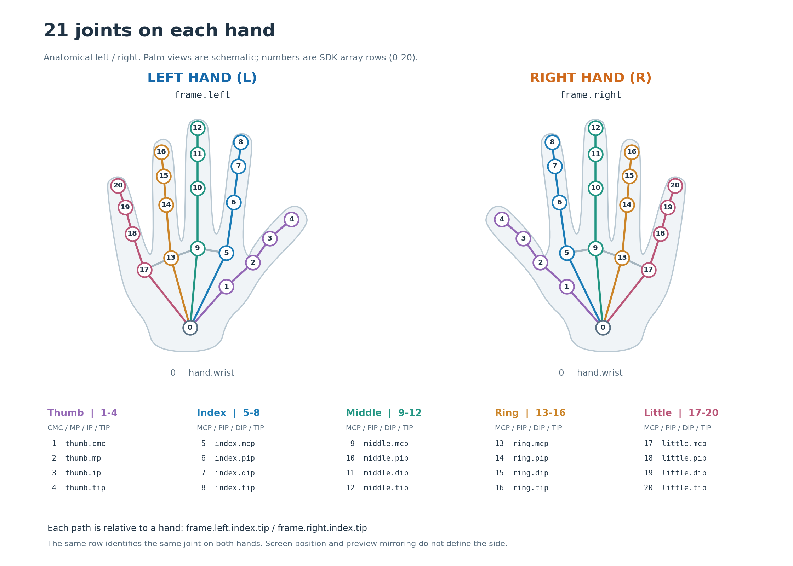
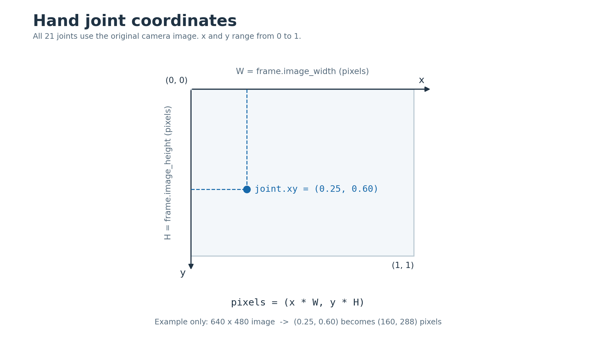

# 手部数据：左右手、21 个节点与可视化

接收一次 `frame = sub.receive()`，再按「手 → 手指 → 节点」读取：`frame.left.index.tip` 是左手食指尖，`frame.right.thumb.tip` 是右手拇指尖。`receive()` 等待一帧有效数据，返回 `HandPoseFrame`；读取节点前检查手和节点是否为 `None`。

## 统一的接收方法

所有 SDK 接收器，包括 AR、IMU、手柄、身体、手部、脸部、AirPods、夹爪和 Watch，都使用 `receive()`。Watch 返回一个 `WatchBatch`，其余通道返回各自的帧对象。

| 调用 | 返回与行为 |
| --- | --- |
| `sub.receive()` | 等待有效帧，返回 `HandPoseFrame`，不会返回 `None` |
| `sub.receive(timeout=50)` | 最多等待 50 毫秒，返回帧；超时返回 `None` |
| `sub.receive(timeout=0)` | 立即检查是否有帧，没有则返回 `None` |
| `sub.receive(timeout=-1)` / `sub.receive(timeout=None)` | 与无参数调用一样，持续等待有效帧 |

接收器关闭后，上述调用都抛出 `StopIteration`。超时是整数毫秒。可视化使用短超时并把 `None` 传给窗口，持续处理窗口事件。旧的 `get()` / `get_frame()` 保留兼容；新代码统一使用 `receive()`。

## 返回的数据是什么

`HandPoseFrame`、`Hand`、`HandFinger`、`HandThumb` 和 `HandJoint` 都是 Python 数据类对象。通过属性逐层读取，同一帧的手、节点和图像尺寸来自同一条消息。以下数值仅用于说明结构，省略了其他节点；协议浮点数在打印时可能有更多小数位。

```text
frame: HandPoseFrame
  timestamp = 12.5
  image_width = 640, image_height = 480
  left: Hand(side=HandSide.LEFT, confidence=0.95)
    index: HandFinger
      tip: HandJoint(name='index_tip', x=0.25, y=0.60, confidence=0.90)
  right = None
  hand_count = 1, unknown_hand_count = 0
```

| 读取结果 | Python 类型 | 格式与含义 |
| --- | --- | --- |
| `frame.timestamp` / `frame.source_timestamp` | `float` | 源相机图像的时间，单位秒；两个属性相同 |
| `frame.image_width` / `frame.image_height` | `int` | 原始图像宽、高，单位像素；0 表示未提供可用尺寸 |
| `frame.left` / `frame.right` | `Optional[Hand]` | 本帧该侧的手，未检测到时为 `None` |
| `frame.hands` | `Tuple[Hand, ...]` | 本帧分配了左右的手；0、1 或 2 个对象，按左、右顺序排列 |
| `hand.side` / `hand.side.value` | `HandSide` / `str` | 左右枚举 / `"left"`、`"right"` 字符串 |
| `hand.confidence` | `float` | 整只手的检测置信度，通常为 0–1 |
| `hand.thumb` | `HandThumb` | 拇指节点分组：`cmc`、`mp`、`ip`、`tip` |
| `hand.index` / `middle` / `ring` / `little` | `HandFinger` | 食指、中指、无名指、小指分组：`mcp`、`pip`、`dip`、`tip` |
| `hand.index.tip` 等节点 | `Optional[HandJoint]` | 一个具体节点，缺失时为 `None` |
| `frame.left.wrist.name` | `str` | 协议节点名称，例如 `"index_tip"`，即食指尖 |
| `frame.left.middle.tip.x` / `frame.right.ring.tip.y` | `float` | 原始图像中的二维归一化位置，通常为 0–1 |
| `frame.left.thumb.tip.xy` | `Tuple[float, float]` | `(x, y)`，例如 `(0.25, 0.60)` |
| `frame.left.little.tip.confidence` | `float` | 该节点的置信度，通常为 0–1；与整只手的置信度分别读取 |
| `frame.right.wrist.to_pixels(width, height)` | `Tuple[float, float]` | 连续像素坐标，例如 `(160.0, 288.0)` |
| `hand.joints` | `HandJoints` | 以协议名称为键、`HandJoint` 为值的字典，也支持枚举键和属性访问 |
| `frame.protobuf` | 生成的 Protobuf 消息 | 已接收的原始 `Phone.HandPoseFrame`，访问它不会再接收一帧 |

`frame.hands` 会跳过缺失手，因此只有右手时 `frame.hands[0]` 就是右手；需要固定侧别时使用 `frame.left` / `frame.right`。没有检测到双手的消息仍是有效 `HandPoseFrame`，其 `left`、`right` 为 `None`、`hands=()`、`hand_count=0`；这与超时返回的 `frame is None` 不同。手存在时，手指分组仍会返回对象，其缺失的节点属性为 `None`。

## 左右手的含义

左右以**被识别者自身的左手和右手**为准。双手在画面里交换位置、交叉，或者预览采用镜像，都不应由接收端交换左右标签。

| 读取方式 | 含义 |
| --- | --- |
| `frame.left` / `frame.right` | 对应侧的 `Hand`；本帧未检测到时为 `None` |
| `frame.hands` | 本帧已分配左右的手，按左、右顺序排列，跳过缺失手 |
| `hand.side` | `HandSide.LEFT` / `HandSide.RIGHT`；把手传入其他函数后仍能区分左右 |
| `frame.unknown_hand_count` | 检测到但无法分配左右的数量；这些检测不会被猜测成左手或右手 |
| `frame.timestamp` | 当前手部识别所用相机图像的时间，单位秒 |

SDK 直接保留发送端 `left_hand` / `right_hand` 的归属，不按 X 坐标猜测。`hand.confidence` 是手部检测置信度，不能当成左右归属的置信度。手部遮挡、快速翻转和交叉时，发送端的识别仍需与实际动作对照。

旧的 `frame.left_hand` / `frame.right_hand` 和 `hand.joints.index_tip` 继续可用，指向同一个对象。独立构造的 `Hand` 默认 `side=HandSide.UNKNOWN`；只有已知归属时才指定侧别。

## 每只手的节点位置



图中是掌面朝向观察者的示意位置。左右手各自拥有相同的 **0–20 固定编号**；这些编号也是 `hand.as_arrays()` 的前 21 行。实际相机图像中的位置和朝向会随动作变化。

下表中的 `hand` 可以是 `frame.left` 或 `frame.right`。所有节点返回 `HandJoint` 或 `None`。

| 编号 | 读取路径 | 解剖位置 |
| ---: | --- | --- |
| 0 | `hand.wrist` | 手腕 |
| 1 | `hand.thumb.cmc` | 拇指根部的腕掌关节 |
| 2 | `hand.thumb.mp` | 拇指掌指关节 |
| 3 | `hand.thumb.ip` | 拇指指间关节 |
| 4 | `hand.thumb.tip` | 拇指尖 |
| 5 | `hand.index.mcp` | 食指掌指关节，连接手掌 |
| 6 | `hand.index.pip` | 食指近端指间关节 |
| 7 | `hand.index.dip` | 食指远端指间关节，靠近指尖 |
| 8 | `hand.index.tip` | 食指尖 |
| 9 | `hand.middle.mcp` | 中指掌指关节 |
| 10 | `hand.middle.pip` | 中指近端指间关节 |
| 11 | `hand.middle.dip` | 中指远端指间关节 |
| 12 | `hand.middle.tip` | 中指尖 |
| 13 | `hand.ring.mcp` | 无名指掌指关节 |
| 14 | `hand.ring.pip` | 无名指近端指间关节 |
| 15 | `hand.ring.dip` | 无名指远端指间关节 |
| 16 | `hand.ring.tip` | 无名指尖 |
| 17 | `hand.little.mcp` | 小指掌指关节 |
| 18 | `hand.little.pip` | 小指近端指间关节 |
| 19 | `hand.little.dip` | 小指远端指间关节 |
| 20 | `hand.little.tip` | 小指尖 |

拇指用 `cmc → mp → ip → tip`，其余四指用 `mcp → pip → dip → tip`。`HandThumb` 和 `HandFinger` 提供明确的属性，编辑器可以补全。关节缺失时只返回 `None`，不填入 `(0, 0)`；坐标为零也可能是真实测量。

## 读取坐标和置信度

**所有手部节点都是原始相机图像中的二维位置。** `frame.left.thumb.tip.xy` 返回 Python 浮点数元组 `(x, y)`，采用归一化图像坐标：原点在左上角，X 向右、Y 向下。`(0, 0)` 表示左上角，`(0.5, 0.5)` 表示图像中心，`(1, 1)` 表示右下边界。



**图像实际宽高从这一帧读取：** `W = frame.image_width`、`H = frame.image_height`，类型都是 `int`，单位是像素。这是用于该次手部识别的原始图像尺寸，随设备和当前相机配置变化，应逐帧读取。图中的 **640×480 仅为示例**。W 或 H 为 0 时没有可用尺寸，保留归一化坐标并跳过像素换算。

以下表格使用不同手指和左右手作为例子；所有 21 个关节都支持同样的坐标与置信度属性。读取完整路径前，先检查对应的手和关节是否存在：

| 数值 | 类型与范围 | 含义 |
| --- | --- | --- |
| `frame.left.middle.tip.x` | `float`，`[0.0, 1.0]` | 水平位置占图像宽度的比例；0 是左边界，1 是右边界 |
| `frame.right.ring.tip.y` | `float`，`[0.0, 1.0]` | 垂直位置占图像高度的比例；0 是上边界，1 是下边界 |
| `frame.left.little.tip.confidence` | `float`，`[0.0, 1.0]` | 这个节点的检测置信度，越高表示越有把握 |
| `frame.right.wrist.to_pixels(W, H)` | `Tuple[float, float]` | 连续像素坐标 `(x × W, y × H)`；X 为 0–W，Y 为 0–H |

例如，`frame.left.thumb.tip.xy` 的值 `(0.25, 0.60)` 表示被识别者自身的**左手拇指尖**位于图像从左向右 25%、从上向下 60% 的位置。如果该帧的 W=640、H=480，`frame.left.thumb.tip.to_pixels(W, H)` 得到约 `(160.0, 288.0)`。`confidence=0.90` 描述这个点的识别置信度，与位置分别读取。关节点数值表示图像中的位置，而非角度或米制三维位置。

SDK 保留收到的原值；像素换算不自动取整、裁剪、镜像或旋转。作为图像数组下标时，有效整数列为 `0…W-1`，行为 `0…H-1`，边界点要检查后再索引。预览经过旋转、镜像或裁剪时，叠加点也要应用相同的显示变换。节点缺失时返回 `None`，坐标 `(0, 0)` 可以是真实测量。

下面的完整示例分别读取左右手的手腕和全部五个指尖，并换算为像素坐标。其他关节也可使用同样的方式读取：

```python
from asmagic import HandPoseDataSubscriber

IPHONE_IP = "192.168.1.100"  # Replace with your iPhone's IP address.


def print_hand_pixels(side, hand, width, height):
    print(f"\n{side} hand:")
    if hand is None:
        print("  Not detected")
        return

    named_joints = [
        ("Wrist", hand.wrist),
        ("Thumb fingertip", hand.thumb.tip),
        ("Index fingertip", hand.index.tip),
        ("Middle fingertip", hand.middle.tip),
        ("Ring fingertip", hand.ring.tip),
        ("Little fingertip", hand.little.tip),
    ]
    for location, hand_joint in named_joints:
        if hand_joint is None:
            print(f"  {location}: not detected")
            continue
        print(f"  {location}: normalized (x, y)={hand_joint.xy}")
        if width > 0 and height > 0:
            print(f"  {location}: pixels (x, y)="
                  f"{hand_joint.to_pixels(width, height)}")


def main():
    sub = HandPoseDataSubscriber(IPHONE_IP)
    try:
        while True:
            frame = sub.receive()
            width, height = frame.image_width, frame.image_height
            print("\nTime:", frame.timestamp)
            print("Image size (width, height):", (width, height))
            if width <= 0 or height <= 0:
                print("Image size unavailable; printing normalized coordinates only")
            print_hand_pixels("Left", frame.left, width, height)
            print_hand_pixels("Right", frame.right, width, height)
    except (KeyboardInterrupt, StopIteration):
        pass
    finally:
        sub.close()


if __name__ == "__main__":
    main()
```

批量读取用 `hand.as_arrays()`，返回 `HandJointArrays`。当前 21 个标准节点的格式如下，各字段的行一一对应。

| 字段 | 类型、形状 | 行的含义 |
| --- | --- | --- |
| `names` | `Tuple[str, ...]`，长度 21 | 每一行的关节名称，覆盖手腕与五根手指 |
| `points` | `numpy.ndarray`，`float32`，`(21, 2)` | 每行 `[x, y]`，行号对应上方的 21 个关节 |
| `confidences` | `numpy.ndarray`，`float32`，`(21,)` | 每个节点的置信度 |
| `valid` | `numpy.ndarray`，`bool`，`(21,)` | 该节点是否存在；不表示已达到置信度阈值 |

第 0 行是手腕；1–4 行是拇指，5–8 行是食指，9–12 行是中指，13–16 行是无名指，17–20 行是小指。缺失节点保留原行，坐标和置信度为 `NaN`、`valid=False`；置信度阈值由业务自行选择。未来扩展节点按名称排序追加到前 21 行之后，届时数组长度为 N。完整的逐行读取示例见 [手部数组示例](examples/hand.md)。

## 可视化窗口 API

`HandTrackingWindow` 创建一个可复用的双手窗口。左手是蓝色 L 面板，右手是橙色 R 面板；每个面板保持原始图像坐标，并默认标注节点名称与编号。面板的排列不代表手在相机画面中的左右位置。

```python
from asmagic import HandPoseDataSubscriber, HandTrackingWindow

IPHONE_IP = "192.168.1.100"  # Replace with your iPhone's IP address.
SHOW_SKELETON = True


def main():
    sub = HandPoseDataSubscriber(IPHONE_IP)
    viewer = None
    try:
        viewer = HandTrackingWindow(labels=True, min_confidence=0.5) if SHOW_SKELETON else None
        while True:
            frame = sub.receive(timeout=50)
            if viewer is not None:
                if not viewer.is_open:
                    break
                viewer.update(frame)
            if frame is None:
                continue
            print("Time:", frame.timestamp)
            print("Left hand detected:", frame.left is not None)
            print("Right hand detected:", frame.right is not None)
    except (KeyboardInterrupt, StopIteration):
        pass
    finally:
        if viewer is not None:
            viewer.close()
        sub.close()


if __name__ == "__main__":
    main()
```

| API | 行为 |
| --- | --- |
| `HandTrackingWindow(labels=True, max_fps=30, stale_after=2.0, min_confidence=0.0)` | 创建窗口；在收到第一帧之前也可关闭 |
| `window.update(frame, force=False)` | 绘制已经收到的 `HandPoseFrame`，返回此窗口；不读取另一帧 |
| `window.update(None)` | 接收超时时处理窗口事件；超过 `stale_after` 秒后清除旧节点 |
| `window.is_open` | 是否仍可更新；关闭窗口后停止接收循环 |
| `window.save(path)` | 导出当前图像，例如 `hands.png` |
| `window.close()` | 释放窗口；也支持 `with HandTrackingWindow() as window` |

窗口需要在主线程运行，并使用带图形界面的 Matplotlib 后端。`min_confidence` 只过滤显示，`max_fps` 只限制绘图；收到的原始数据不变。缺失或被过滤的节点不会被骨骼连线跨越。只显示一只已取出的手时，可以复用 `TrackingPlotter` 调用 `window.update(hand)`，它会保留 `hand.side` 的左右标记。

在 App 的 **Stream** 开启手部输出，或在 **Face and Hand Tracking** 开启 **Hand tracking** 并点击 **Send hands**。当前手部与脸部是独立的数据流；各有自己的识别时间戳。旧版合并帧的 `frame.hand_pose` 也提供相同手部 API。

两张图提供可编辑的 [节点图 SVG](assets/hand-joint-map.svg) 和 [图像坐标图 SVG](assets/hand-reading-flow.svg)。
