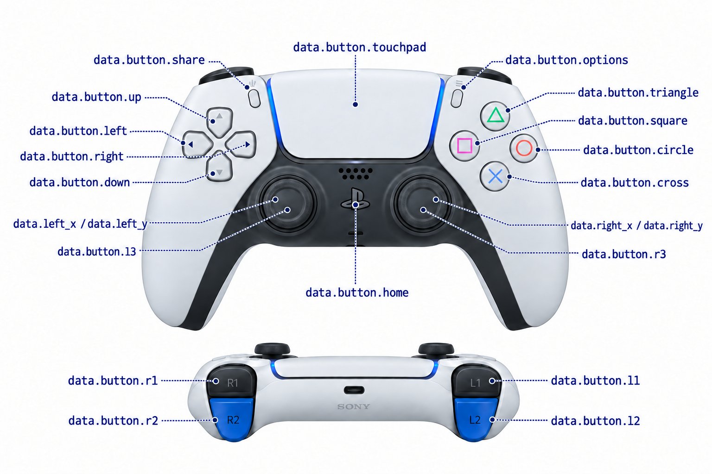
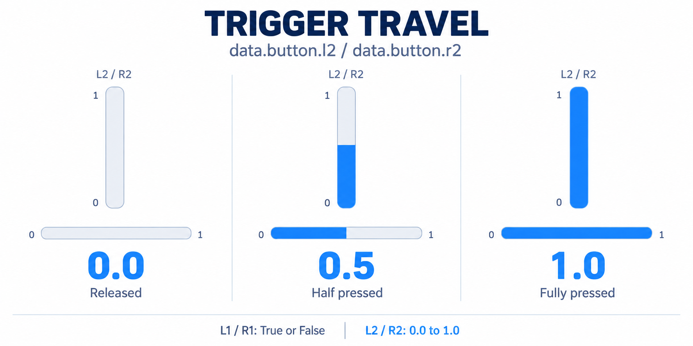

# Joystick API

Receive one frame with `data = sub.receive()`, then read its sticks and named buttons. Ordinary buttons are `bool`; L2/R2 are `float` from 0.0 to 1.0.

## Buttons

| API | Control | Type |
| --- | --- | --- |
| `data.button.triangle` | △ Triangle | `bool` |
| `data.button.square` | □ Square | `bool` |
| `data.button.cross` | × Cross | `bool` |
| `data.button.circle` | ○ Circle | `bool` |
| `data.button.l1` | Left shoulder button | `bool` |
| `data.button.r1` | Right shoulder button | `bool` |
| `data.button.l2` | Left trigger | `float`, 0.0–1.0 |
| `data.button.r2` | Right trigger | `float`, 0.0–1.0 |
| `data.button.up` | ↑ | `bool` |
| `data.button.down` | ↓ | `bool` |
| `data.button.left` | ← | `bool` |
| `data.button.right` | → | `bool` |
| `data.button.share` | Create / Share, left of the touchpad | `bool` |
| `data.button.options` | Options, right of the touchpad | `bool` |
| `data.button.home` | PS / Home, between the sticks | `bool` |
| `data.button.touchpad` | Touchpad click | `bool` |

## Sticks

| API | Control | Type |
| --- | --- | --- |
| `data.left_x` / `data.left_y` | Left stick X / Y | `float`, −1.0–1.0 |
| `data.right_x` / `data.right_y` | Right stick X / Y | `float`, −1.0–1.0 |
| `data.button.l3` | Press the left stick | `bool` |
| `data.button.r3` | Press the right stick | `bool` |

X is right-positive; Y is up-positive; center is 0.0.

## Status and motion

| API | Type | Value |
| --- | --- | --- |
| `data.timestamp` | `float` | Sample time in seconds |
| `data.controller_name` | `str` | Controller name |
| `data.is_connected` | `bool` | Physical controller connected |
| `data.battery_level` | `float` | Battery level, 0.0–1.0, when reported |
| `data.is_charging` | `bool` | Charging, when reported |
| `data.has_motion` | `bool` | Motion sensors available and active |
| `data.gravity` | `np.ndarray` | `[x, y, z]`, G |
| `data.user_acceleration` | `np.ndarray` | Acceleration without gravity, `[x, y, z]`, G |
| `data.rotation_rate` | `np.ndarray` | Angular velocity `[x, y, z]`, rad/s |
| `data.attitude` | `np.ndarray` | Quaternion `[qx, qy, qz, qw] |

Physical and on-screen input use the same fields. Unavailable buttons are false, triggers are 0.0, and motion arrays are empty.

## Old API

| Old API | Control | Type |
| --- | --- | --- |
| `data.timestamp` | Sample time in seconds | `float` |
| `data.left_x` / `data.left_y` | Left stick X / Y | `float`, −1.0–1.0 |
| `data.right_x` / `data.right_y` | Right stick X / Y | `float`, −1.0–1.0 |
| `data.button1` | △ Triangle | `bool` |
| `data.button2` | □ Square | `bool` |
| `data.button3` | × Cross | `bool` |
| `data.button4` | ○ Circle | `bool` |

| Receiver | Returns |
| --- | --- |
| `sub.receive()` | `JoystickFrame` |
| `sub.receive(timeout=1000)` | `JoystickFrame` or `None` on timeout |
| `sub.close()` | `None` |

[Complete runnable examples](examples/joystick.md)
